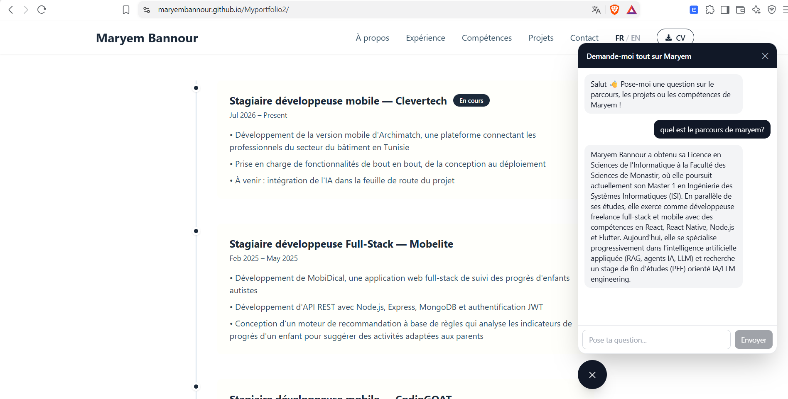

# Maryem Bannour: Portfolio with a RAG Chatbot

Personal portfolio website with an integrated AI chatbot that answers visitors' questions about my background, experience, projects and skills. The chatbot uses Retrieval-Augmented Generation (RAG): it only answers from my own documents, so it doesn't invent information about me.

**Live site:** [maryembannour.github.io/Myportfolio2](https://maryembannour.github.io/Myportfolio2/)



## Features

- Responsive portfolio with About, Experience, Skills, Projects (with detail pages) and Contact sections
- Bilingual interface (French / English) with a language switcher
- Downloadable CV in English and French
- Floating chat widget connected to a custom RAG backend
- Chatbot restricted to my profile: off-topic questions get a polite refusal
- CI/CD with GitHub Actions: static export deployed to GitHub Pages on every push to `main`

## How the chatbot works

```
 Markdown docs ──► chunking ──► embeddings ──► data/embeddings.json
 (backend/docs)   (per "##")    (Gemini)         (loaded in memory at startup)

 Visitor question ──► embed ──► cosine similarity ──► top 4 chunks ──► Gemini ──► answer
```

1. **Ingestion:** `generate-embeddings.js` reads every Markdown file in `backend/docs/` and splits it into chunks, one per `##` section.
2. **Embeddings:** each chunk is embedded with the `gemini-embedding-001` model and saved to `backend/data/embeddings.json`.
3. **Retrieval:** when a visitor asks a question, it is embedded the same way. The 4 most similar chunks are selected by cosine similarity.
4. **Generation:** the chunks are passed as context to a Gemini model, with a system prompt that forces answers to stay grounded in that context.

Updating the chatbot's knowledge only means editing the Markdown files and re-running the embedding script. No code change is needed.

## Tech stack

| Layer | Technologies |
|---|---|
| Frontend | Next.js 15, React 19, Tailwind CSS, React Icons |
| Backend | Node.js, Express, CORS, dotenv |
| AI | Google Gemini API (`@google/genai`): embeddings and text generation |
| Deployment | GitHub Pages (frontend), Render (backend) |
| CI/CD | GitHub Actions |

## Project structure

```
Myportfolio2/
├── frontend/                  # Next.js app (static export)
│   ├── app/                   # Pages and layout
│   ├── components/            # Hero, Experience, Projects, Skills, Contact, ChatWidget...
│   ├── context/               # LanguageContext (FR/EN)
│   ├── data/                  # Projects data and translations
│   └── public/                # Images, icons, CVs
├── backend/                   # RAG API
│   ├── docs/                  # Knowledge base (Markdown): bio, experiences, projects, skills
│   ├── data/embeddings.json   # Generated embeddings
│   ├── scripts/generate-embeddings.js
│   └── server.js              # Express server
└── .github/workflows/nextjs.yml
```

## Getting started

**Prerequisites:** Node.js 20+ and a [Google AI Studio](https://aistudio.google.com) API key.

```bash
git clone https://github.com/MaryemBannour/Myportfolio2.git
cd Myportfolio2
```

### 1. Backend

```bash
cd backend
npm install
cp .env.example .env           # then add your GEMINI_API_KEY
npm run generate-embeddings    # builds data/embeddings.json from backend/docs
npm start                      # http://localhost:3001
```

### 2. Frontend

```bash
cd frontend
npm install
echo "NEXT_PUBLIC_RAG_API_URL=http://localhost:3001" > .env.local
npm run dev                    # http://localhost:3000
```

## Environment variables

| Variable | Where | Description |
|---|---|---|
| `GEMINI_API_KEY` | `backend/.env` | Google Gemini API key (required) |
| `PORT` | `backend/.env` | Server port (default `3001`) |
| `NEXT_PUBLIC_RAG_API_URL` | `frontend/.env.local` | URL of the RAG backend |

## API

| Method | Endpoint | Description |
|---|---|---|
| `POST` | `/chat` | Body: `{ "message": "..." }`. Returns `{ "reply": "..." }` |
| `GET` | `/health` | Returns the server status and the number of loaded chunks |

## Deployment

- **Backend:** hosted on Render. `embeddings.json` is committed, so the server starts without regenerating embeddings.
- **Frontend:** built as a static site (`next build`, output in `frontend/out`) and deployed to GitHub Pages by the GitHub Actions workflow. The build injects `NEXT_PUBLIC_RAG_API_URL` pointing to the Render backend.

## Related project

[Portfolio MCP Server](https://github.com/MaryemBannour/portfolio-mcp-server): an MCP server exposing the same profile data (experiences, projects, skills) as tools for AI assistants, with read and write access.

## Author

**Maryem Bannour**: [LinkedIn](https://www.linkedin.com/in/maryem-bannour-299937311) · [GitHub](https://github.com/MaryemBannour)